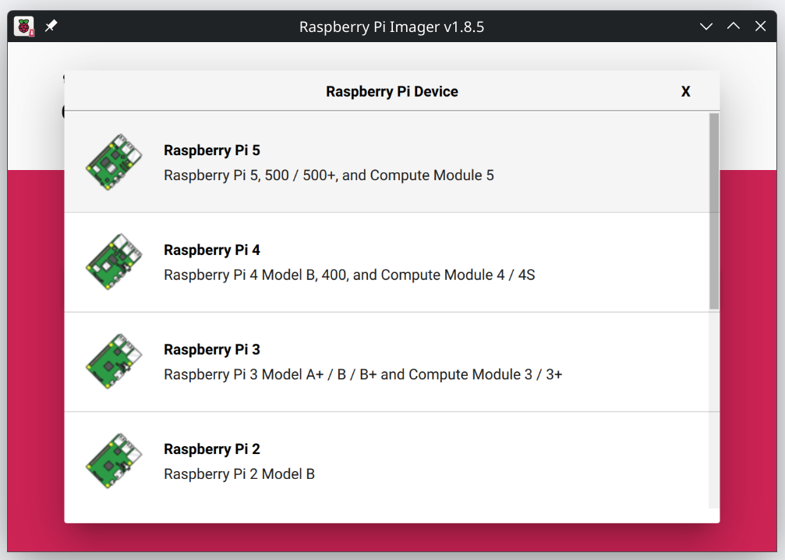
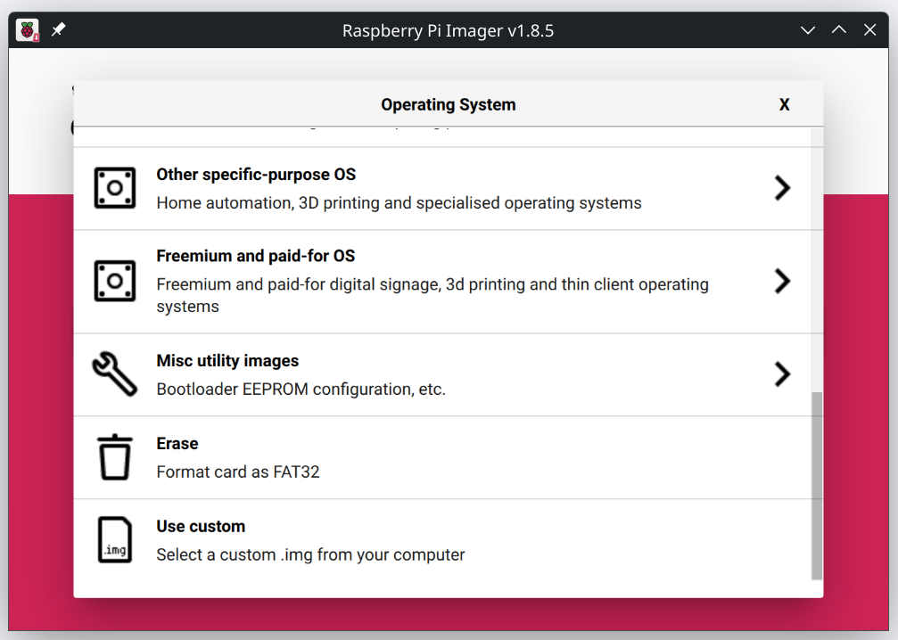
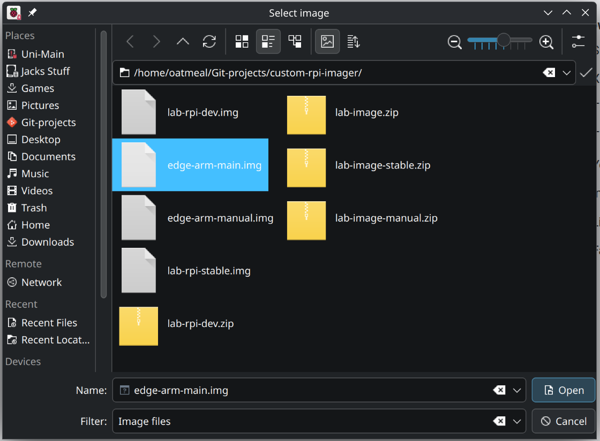
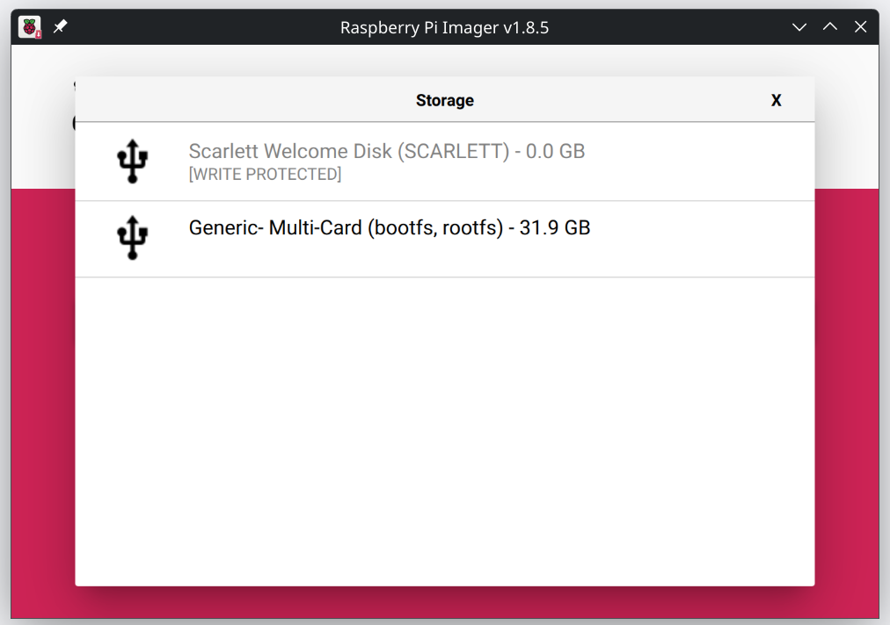
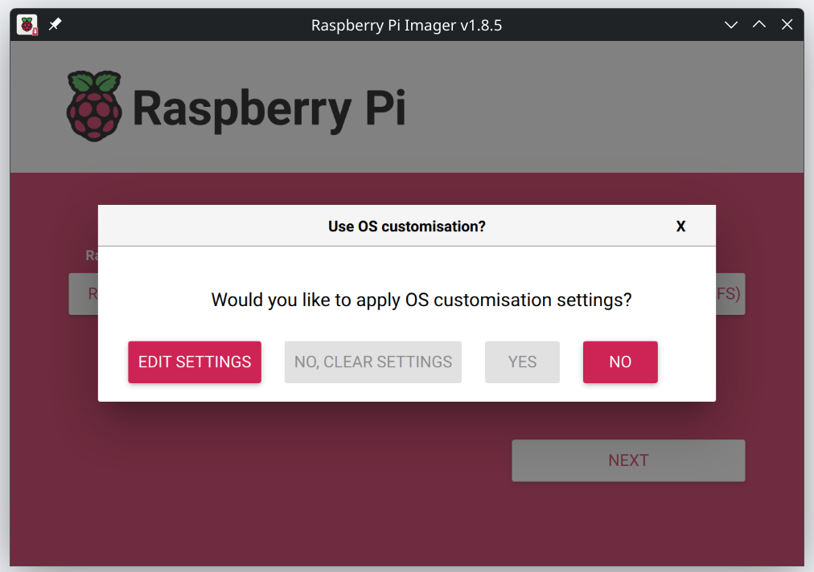
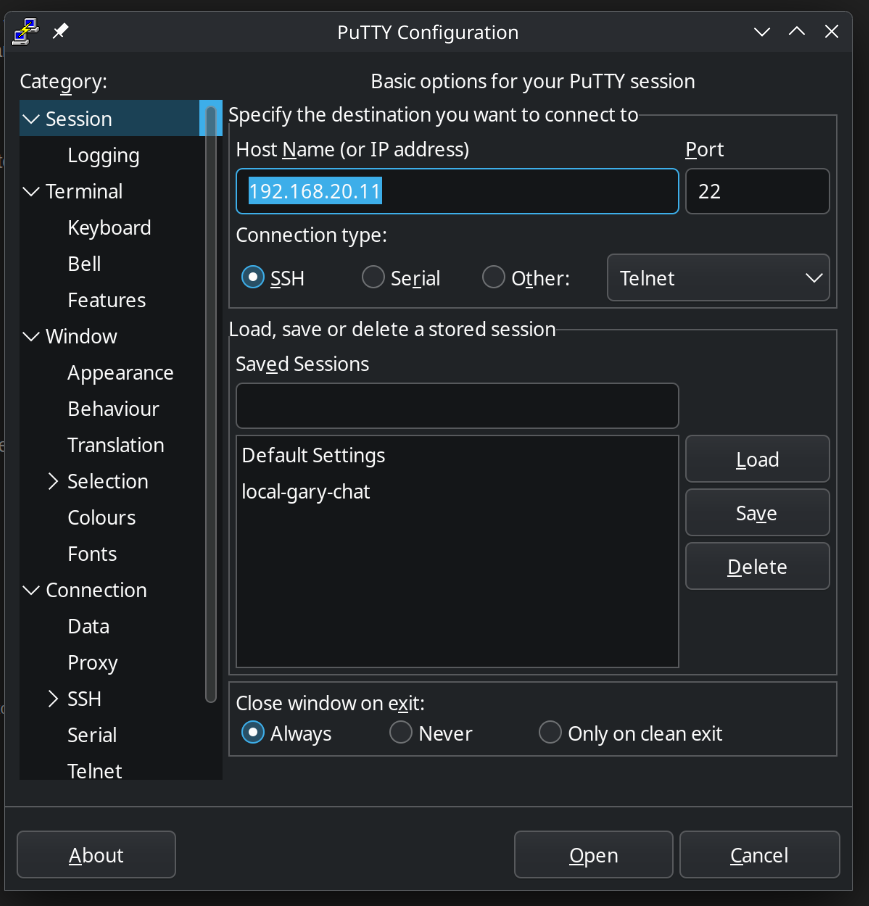
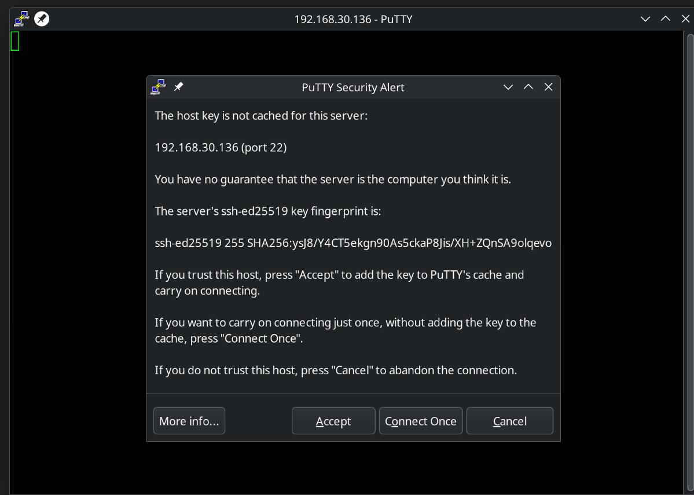

# Installing The Edge

There are two methods for configuring a R-PI for production use, we reccomend using our provided custom raspberry pi image. If you wish to configure your raspberry pi without our image or need to run our system on another hardware platform we have also included steps on how to do so. 

-------------------------------------

## Custom Image 

### Image Burning and Setup

#### SD card burning

Navigate too https://github.com/laser-vision-system/custom-rpi-imager/releases/tag/stable.1 and download lab-image-stable.zip and extract the image.

Insert the SD card you want to image and download Raspberry Pi's Image burning software www.raspberrypi.com/software. 


Select "choose device" and nominate the model of raspbery pi you have. 



Select choose OS and scroll down to "Use custom", when prompted navigate too and select our image. 



 

Select "choose storage" and nominate your SD card. 




Select "Next" and when asked select No. 

 

Wait for the burn to complete and when prompted remove the SD card. 

Insert the SD card into your raspberry pi and wait for it to boot, If everything has worked correctly you should see a new edge device connect. 

#### Post Burn 

If the edge does not connect immediately you may wish to connect via SSH and confirm the status. 

**It can take the R-PI 5-10 minutes to connect, please be patient**

Navigate to 192.168.20.1 and check the connected clients, the new raspberry pi will have a host name of `laser-alignment-pi`. record the IP address so you can connect to it shortly. 

Download and install PuTTY https://putty.org/index.html. 

Run PuTTY and enter the IP address you found earlier into the "Host Name (or IP address)" field. 



When asked press accept. 



When prompted enter the username:

`lab_admin`

and the password is:

`TallGoggles5$2`

this user has sudo privlidges. 

##### First boot 

If the docker image has not run allready you can start it manually using the following command: 
```
sudo docker run --net=host --privileged --name edge --restart unless-stopped --mount type=bind,src=/dev,dst=/dev ghcr.io/laser-vision-system/edge:arm64-release-main 
```

-------------------------------------

## Setup without an image 
**Note.** This part of the guide will assume you have a hardware machine that meets the minumum secifications for docker and our system, we will also assume that you have terminal or greater access to your system. 

### Installing docker 
Navigate to the corosponding link to install docker for your system

['Ubuntu'](https://docs.docker.com/engine/install/ubuntu/)
['Raspberry-pi-32-bit'](https://docs.docker.com/engine/install/raspberry-pi-os/)
['Raspberry-pi-64-bit-or-Debian'](https://docs.docker.com/engine/install/debian/)
['Windows'](https://docs.docker.com/desktop/setup/install/windows-install/)
['Mac'](https://docs.docker.com/desktop/setup/install/mac-install/)

#### Terminoligy 
during this process you will see two key terms:
- Docker Image
- Docker Container

A docker image is like a blueprint that can be used to build docker containers. 

you can find all avalible images on your machine by running `docker images` 

you can find a list of all active containers by running `docker container ls` 

if you wish to know more this ['article'](https://www.geeksforgeeks.org/devops/difference-between-docker-image-and-container/) explains the differences in greater detail

### Network prep
Make sure your device has access to the internet, if you wish to confirm try to ping `ghcr.io`. If this ping goes through you will be able to pull our docker images. If you are unable to ping this address we have found that while you are on the labs internal network you may need to do the following: 
- disable IPv6
- configure a manual DNS server of `8.8.8.8` and `8.8.4.4`

### Running the docker image 
Now it is time to run our docker image, here is the command you need to run with its corosponding attributes: 
```
docker run \
--net=host \
--privileged \
--name edge \
--restart unless-stopped \
--mount type=bind,src=/dev,dst=/dev \
--detach \
-e SERVER_URL=192.168.20.13:8080 \
-e VERBOSITY=3 \
ghcr.io/laser-vision-system/edge:arm64-release-main 
```
###### --net=host
gives the docker container access to your devices network interface, this is required for auto connecting to the server.

###### --priviledged 
this runs the container in priveledged mode, without this tag our container will fail to access your devices cameras.

###### --name edge
the name of your docker container, this can be changed freely and is the name that will be associated with its container id when you run the command `docker container ls`

###### --retsart unless-stopped
ensures that if your docker container stops running for any reason besisdes intentionally stopping it the container will start back up automaticly e.g. on device restart.

###### --mount type=bind,src=/dev,dst=/dev 
camera devices on linux are mounted to the dev folder in a machines root path, this command can be forgone on other platforms but is nessacary for our container to 

###### --detach 
detaches your terminal from the container when running the container for the first time, the output of the docker run command will provide you with the edge ID and nothing more. if you execute `docker container ls` you can see the container running in the background 

###### -e .......
the two commands listed that start with the prefix `-e` are our enviorment varriables and are tailored to our system, `SERVER_URL` specifies the server address for our system. if not defined on first container run it will default to autoconnect which scans the local network for the server, make sure to include the port when specifying the address which is by default `8080`. the seccond varriable is our error logging verbosity `VERBOSITY` this specifies what level of errors are sent to the server, it ranges from 1 -> 4 with the lower numbers only logging major errors where as 4 will log every occurance on our edge system. 

###### ghcr.io/laser-vision-system/edge:arm64-release-main  
This specfies the image to use for our container, our tags follow a system as follows:

`ghcr.io/laser-vision-system/` - our github orgonization 
`/edge` - our edge program
`arm64` - CPU architecture, raspberry pi's run & macs on `arm64` where as most modern laptops & desktops use `amd64`
`-release-` - Specifies the build target, release has only what is required for production where as the `dev` tag will print debugging alerts in the console
`main` - the github branch that the docker image is built from, `main` is our stable branch and is intended for production use.

### Help! docker could not find the image when trying to run it. 
if you get an error because your system cannot find the docker image localy you might be having network issues, please refer to the troubleshooting steps from early under `Network prep`. if you have preformed the above steps and can ping `ghcr.io` you can try pull the docker image manually. 

```
docker pull ghcr.io/laser-vision-system/edge:arm64-release-main 
```

if this does not work please contact your IT department or the system maintainers. 

### Conclusion 

From this point on the process for updating the docker image will be the same as our provided image, please refer to the read me on how to update your docker image while in production. 

