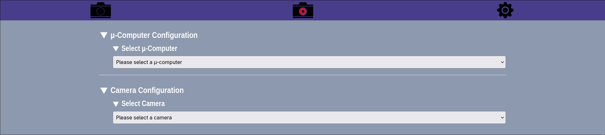
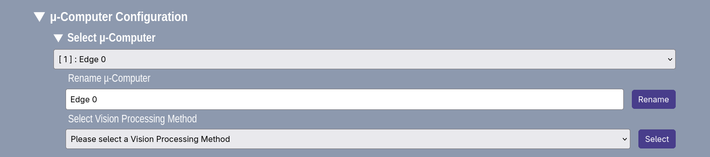
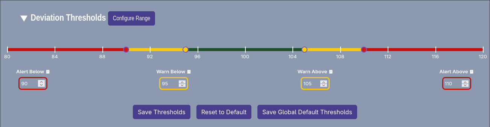
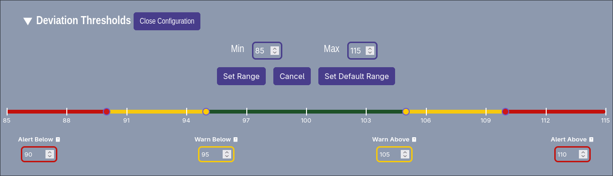

# Device Settings

The Device Settings section is for the configuration of the devices used in this project, such as the cameras and microComputers that are currently being used.

## Edge Device Settings

Edge devices refer to the Raspberry Pi(s) that is used to run the edge. The edge can also be run on any computer. However, using a microComputer such as the Raspberry Pi is recommended due to its small form factor that fits well in the tightly-packed laser lab.

`The connected Edge devices can be configured to:`

- Be selected to filter the specific options for all the connected cameras, displayed in the camera configuration below.
- Be renamed, allowing the user to give a meaningful identifier to the device.
- Run a specific vision processing technique. Note: this will select the processing technique for all cameras connected to the microComputer.

## Cameras

The cameras that can be configured are the ones that are connected to the system, and have their state as active.

`The connected Cameras can be configured to:`

- Rename the selected camera to a more meaningful name (e.g. what it is observing).
- Change the selected camera controls for tweaks to help improve the vision processing. `Some camera controls to consider are:`
  - PUT IMPORTANT CAMERA CONTROLS HERE
    
- Set the deviation thresholds for the selected camera (e.g. if a camera is misbehaving and needs a custom deviation range to keep it in check).
  
- The range (min - max) of the deviation threshold input slider can be configured to suit the needs of the camera's threshold setup, allowing for fine-tuning of the deviation thresholds.
  
