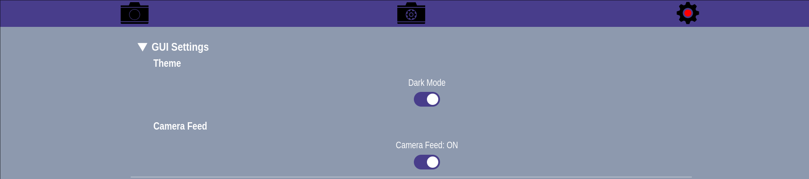
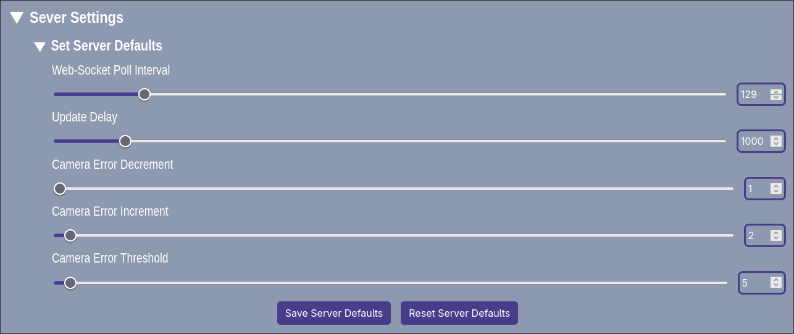

# Global Settings
The Global Settings section is for the configuration of the underlying aspects of the system. It is split into two sections: one for the GUI and the other for the server which includes the default server settings.

## GUI settings

`The global settings for the GUI include:`
- A toggle for the theme of the user interface, it allows the user to switch between light and dark mode. (Dark mode is recommended.)
- A toggle for the viewing of the camera feed throughout the whole application. which helps to declutter.

## Server Settings

`The global settings for the server defaults include:`
- Web-Socket poll interval 
- Update Delay
- Camera Error Decrement
- Camera Error Increment 
- Camera Error Threshold
