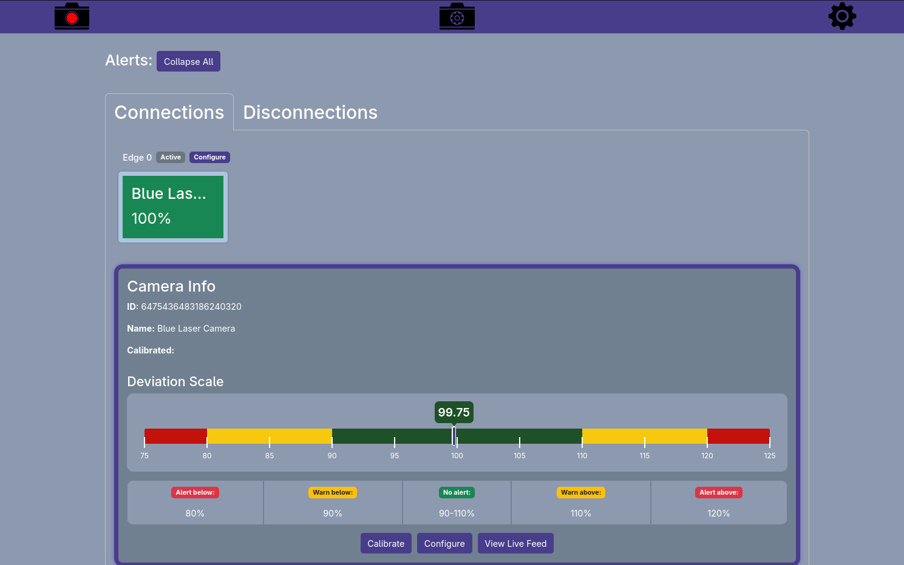
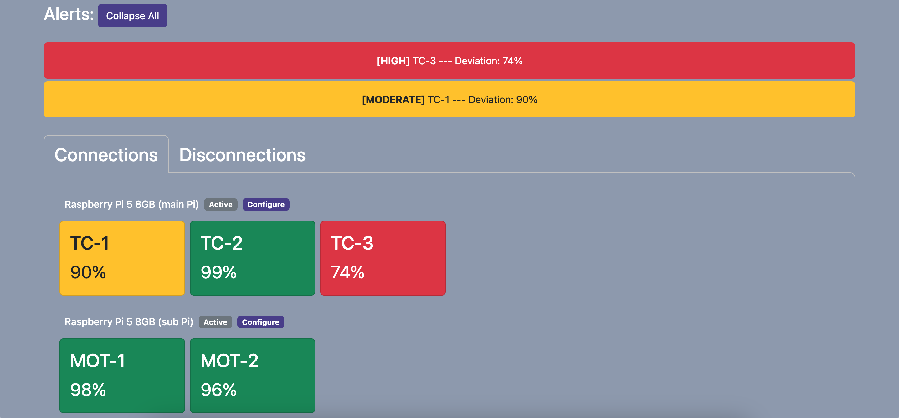

# Homepage

The Homepage is the main dashboard for the laser vision system. Here, you will find all the information needed for standard operations & monitoring activities.

## Alerts

At the top of the page is the alerts section.

It displays important information such as deviation warnings (moderate or high deviations) or device disconnection events. This section can be collapsed if necessary and will show a count of hidden alerts instead.

## Main Section

The main body of the page is information about all devices known by the system.

The first tab shows all currently connected devices while the second tab shows devices that have been disconnected or have encountered an issue that prevents them from operating.

### Connections

This tab shows all currently connected devices.

The cameras are grouped by the edge computing device that they are connected to.

Each connected camera that has been calibrated will show the current deviation value and be coloured to alert if the deviation has drifted outside a set threshold using a stoplight colour system, where:

    Green: deviation within an acceptable range (no alert)
    Yellow: deviation within warning zones (moderate severity alert)
    Red: deviation within unacceptable ranges (high severity alert)

For each edge computing device, there is a shortcut button to quickly access configuration options for it, sending the user to the device settings page with the corresponding edge device pre-selected when clicked.

You may view more details about a camera by clicking its displayed box. From here, you may calibrate the deviation measurement, configure camera settings via the shortcut button to the device settings page, or view the camera's live feed.

### Disconnections

This tab shows devices that are no longer connected to the system as well as faulty camera devices.

These can include:
    - Disconnected edge devices
    - Disconnected cameras
    - Faulty cameras
        - Broken cameras: cameras that have connected & initialised but fail to read a frame too many times
        - Limbo cameras: a connection is detected but the camera cannot be established

Each device has a button to forget the device completely.

Broken cameras have a button to manually force a reconnection attempt.

Limbo cameras only appear briefly before they are classified as broken.
