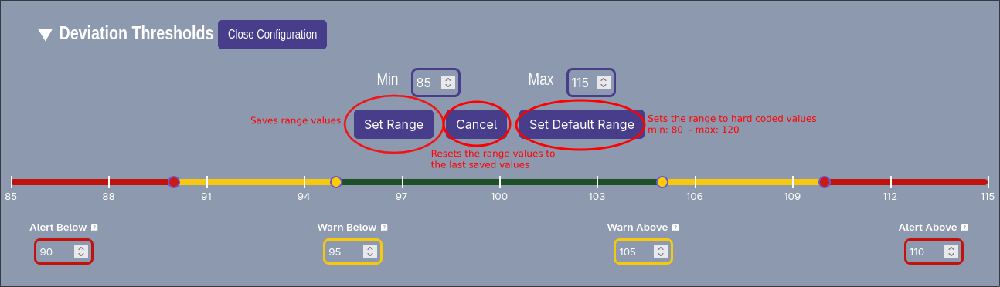

## How to Configure the Deviation Slider's Range

1. To configure the deviation sliders range you must first have a camera selected.
2. Then in the deviation thresholds section of the camera settings. Click on the `Configure Range` button, located to the right of the Deviation Thresholds section label.
3. When the button is clicked the option to edit the min and max of the deviation scale are shown.
4. To save the new configured range, click the `Set Range` button.

To set the new configured range to the application's default  click the `Set Default Range` button. The Application default range is hard coded to `min: 80 ` and `max: 120`

To reset the new configured range to the previously saved values click the `Cancel` button.

To close the range configuration simply click the `Close Configuration` button located in the same location as the Configure Range button.
