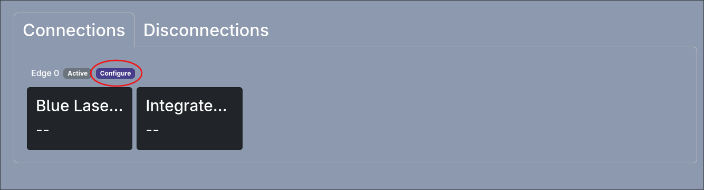
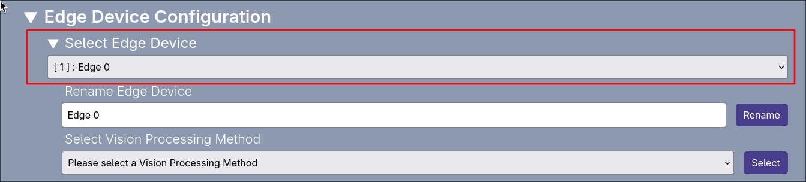

## How to Configure Edge Devices

An edge device can be configured through the homepage by clicking the configure button next the the name of the microcomputer in the connections tab of the homepage. 

Alternatively you can go to the device settings page and select the microcomputer you wish to configure using the drop down menu.

