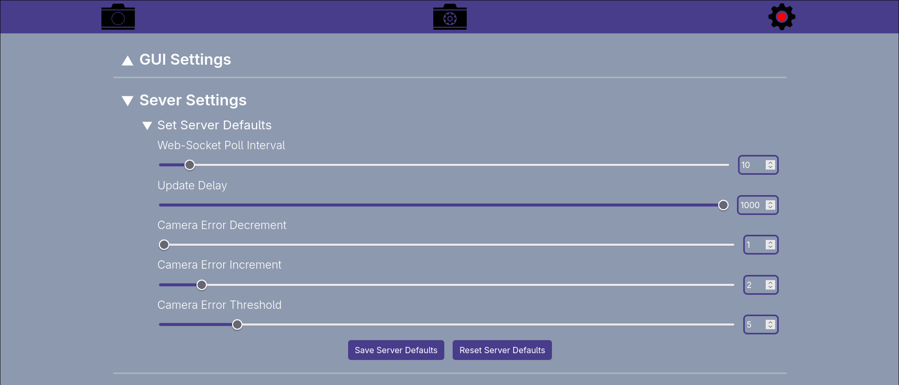
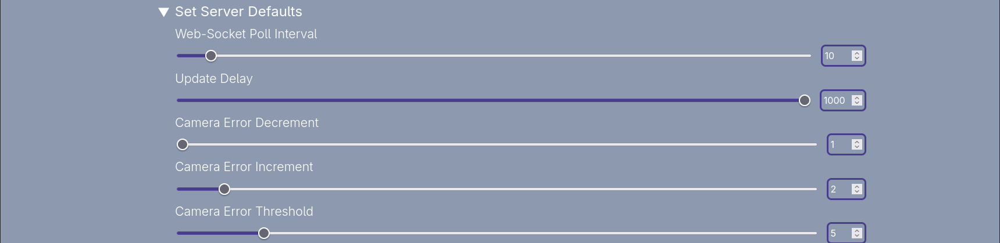
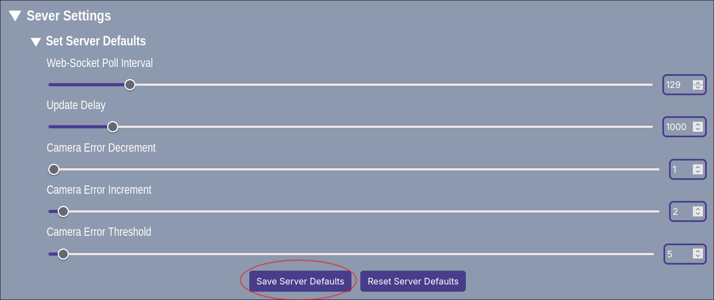
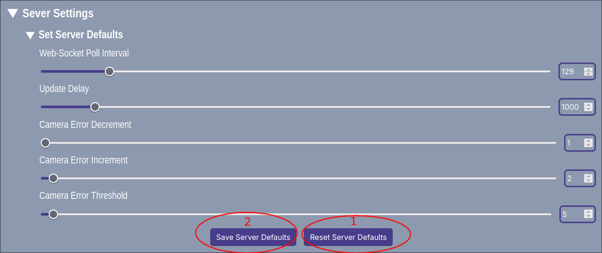

# How to Configure the Server Settings

## Location

The server settings can be configured via the global settings tab, located under the GUI settings section the server settings section has all the settings that can be changed on the server to effect its behaviour. These settings are kept by the server and sent to any edge device (microcomputer) that connects to the server, hence why they are often referred to as the default server settings.

## How to Configure

Similar to the camera controls these settings can be either changed via the sliders or a number input, they all have their respective range and validation to check that the values they are configured to are valid.

## Saving the server values

The server values can be save by clicking the `Save Server Defaults` button when this is clicked the values set will be validated then once deemed valid they are sent to the server via a post request.

## Resetting the Server values

The server defaults are hard coded on the user interface, to reset to the default values, click on the `Reset Server Defaults` button, then to save this change click on the `Save Server Defaults` button.

## To Note

The value of the camera error decrement is not allowed to be lower than the camera error increment. If this is done the custom validation will tell you off with a warning making it impossible to save the values when they are out of their respective bounds.
