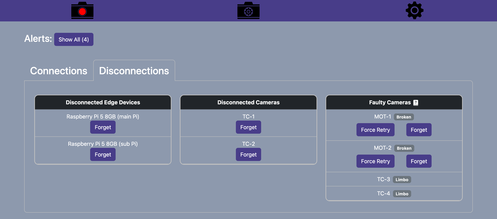
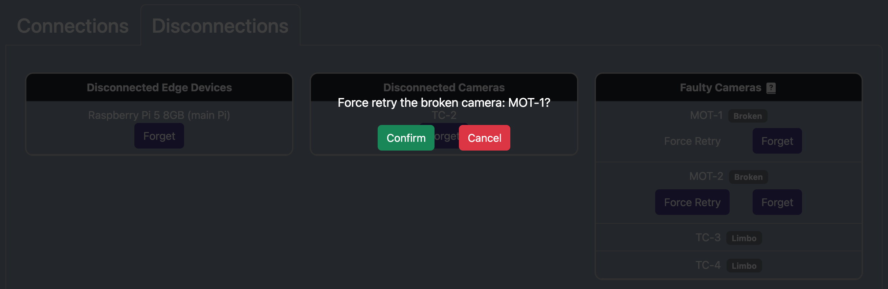

# Force Retry Camera

1. Click the `Force Retry` button on the desired broken camera.

2. Click confirm.

3. The camera will appear under `Connections` if it successfully reconnects, otherwise, where reconnection fails the camera will remain under `Faulty Cameras`.

## Note:

You may wish to forget a broken camera if manual reconnection attempts fail.