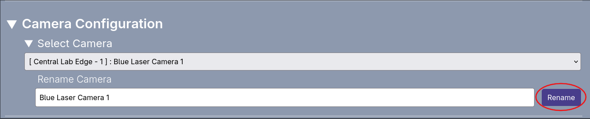

### How to Rename a Camera

1. Ensure that the desired camera is selected in the select camera section, located under the Camera Configuration.
2. Directly under the select camera option, you should see the rename camera option. Simply click on the text box and type in the desired name.
3. To save the new name to the camera name, just click the `Rename` button on the right of the text box and click confirm on the popup message.

It is advised to name the camera based on what it is observing or its position in the laser lab, thus providing meaningful context.
