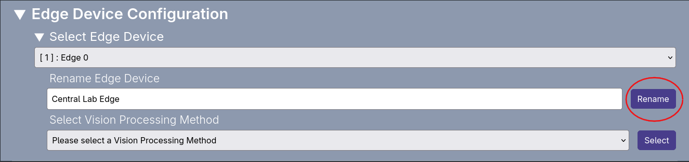

### How to Rename an Edge Device

To Rename an Edge device which is connected to the system:

1. Select the desired Edge Device from the drop down menu directly under the Edge Device configuration section.
2. When selected the Edge Device configuration options should appear below.
3. Click on the text box with the Rename Edge Device label and enter the new name of the Edge Device. We advise a consistent naming scheme of your choice to avoid any confusion.
4. To save the new name of the Edge Device click the `Rename` button next to the text box and click confirm on the confirmation pop-up.

